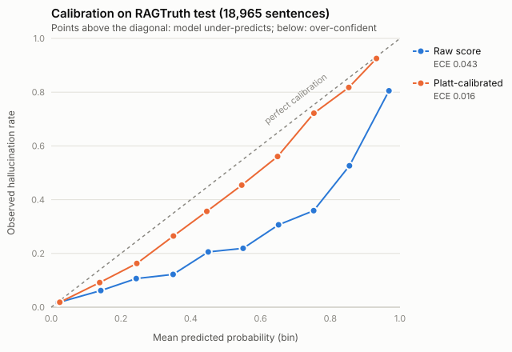

# hallucination-detector

A sentence-level hallucination detector for RAG and other grounded generation. Give it the source material and an
answer; it scores every sentence of the answer for whether the sources support it. It's a fine-tuned
ModernBERT-base (150M parameters) trained in plain PyTorch on RAGTruth, served by a FastAPI endpoint in a CPU
Docker image.

Every number below is recomputed from prediction files committed in [`results/`](results/)
(`python eval/evaluate.py ...`), so each one traces to a file.

## Results

### RAGTruth test set (18,965 sentences, 8.2% hallucinated)

| Method | F1 | Precision | Recall | AUROC |
|---|---|---|---|---|
| **Fine-tuned ModernBERT-base** | **0.652** | **0.653** | 0.651 | **0.916** |
| Zero-shot NLI (`cross-encoder/nli-deberta-v3-base`, windowed) | 0.197 | 0.117 | 0.630 | 0.640 |
| LLM judge (Gemini 3.5 Flash-Lite, 1,000-sentence sample) | *pending: free-tier quota, run in progress* | | | |

The decision threshold is chosen on validation F1 and applied unchanged to test (validation F1 0.671, close to the
test figure).

By task, fine-tuned (F1 / AUROC): Data2txt **0.718 / 0.946**, QA 0.589 / 0.903, Summary 0.446 / 0.807. Summary is
the weak spot; see [Limitations](#limitations).

### Out of domain: LLM-AggreFact (11 grounding datasets, 29,320 test claims)

Balanced accuracy (the benchmark's metric). The model never saw these datasets, apart from RAGTruth.

| | AUROC | BAcc, RAGTruth threshold unchanged | BAcc, per-dataset threshold tuned on AggreFact dev |
|---|---|---|---|
| 10 out-of-domain datasets | 0.767 | 66.1 | 70.2 |
| All 11 (leaderboard set) | 0.781 | 67.4 | **71.5** |

For reference, the [LLM-AggreFact leaderboard](https://llm-aggrefact.github.io/) lists FactCG-DeBERTa-L (0.4B) at
75.6, MiniCheck-Flan-T5-L (0.8B) at 75.0 and Bespoke-MiniCheck-7B at 77.4. Its threshold protocol isn't stated on
that page, so treat this as a loose comparison. Per dataset, the detector is strongest on LFQA (84.1), RAGTruth
(84.6) and REVEAL (78.2), and weakest on AggreFact-CNN (57.3) and ExpertQA (59.0). Full table:
[`results/aggrefact_metrics.json`](results/aggrefact_metrics.json).

### Calibration



Raw scores are over-confident at the top (sentences scored 0.9-1.0 are hallucinated 81% of the time). Platt scaling
fitted on validation brings expected calibration error from **0.043 to 0.016** on test without changing F1 or AUROC.
The API returns the calibrated probability next to the raw score.

<details><summary>Data behind the plot (test set, 10 bins)</summary>

| Bin | n (raw) | Mean raw score | Observed rate | n (Platt) | Mean calibrated | Observed rate |
|---|---|---|---|---|---|---|
| 0.0-0.1 | 14,921 | 0.020 | 0.017 | 15,471 | 0.025 | 0.019 |
| 0.1-0.2 | 1,085 | 0.142 | 0.062 | 1,166 | 0.139 | 0.092 |
| 0.2-0.3 | 507 | 0.244 | 0.107 | 498 | 0.245 | 0.163 |
| 0.3-0.4 | 328 | 0.350 | 0.122 | 321 | 0.350 | 0.265 |
| 0.4-0.5 | 248 | 0.450 | 0.206 | 244 | 0.446 | 0.357 |
| 0.5-0.6 | 210 | 0.550 | 0.219 | 207 | 0.546 | 0.454 |
| 0.6-0.7 | 235 | 0.652 | 0.306 | 214 | 0.649 | 0.561 |
| 0.7-0.8 | 220 | 0.753 | 0.359 | 212 | 0.753 | 0.722 |
| 0.8-0.9 | 287 | 0.855 | 0.526 | 351 | 0.853 | 0.818 |
| 0.9-1.0 | 924 | 0.968 | 0.805 | 281 | 0.933 | 0.925 |

</details>

### Speed

On a Kaggle T4 GPU: 21.6 ms per sentence for the fine-tuned model, against 30.8 ms for the NLI baseline, which has to
score ~2.2 source windows per sentence.

The Docker API on CPU ([`results/api_latency.json`](results/api_latency.json), 200 test responses sent one at a time,
fp32, 4 vCPU of an 8 GB M2 Mac through Colima) takes 1.2 s per sentence: 5.8 s per response at the median and 23.5 s
at p95, longest for Data2txt with its long JSON sources. That is slower than the Gemini 3.5 Flash-Lite judge (median 0.81 s
per call), so CPU serving suits offline or batch checks; a GPU is the option for interactive use. The judge costs about
$0.25 per 1,000 checks at paid-tier prices (~750 input and ~12 output tokens per call), where the detector has no
per-call cost.

## How it works

- **Data** ([`data/prepare.py`](data/prepare.py)): RAGTruth responses are split into sentences. A sentence counts as
  hallucinated if any human-annotated span overlaps it. Validation is carved out of train **by source**, because each
  source has answers from 6 LLMs and a random split would leak; the script asserts no source crosses splits.
  Result: 100k train / 11.7k val / 19k test sentences.
- **Model** ([`src/hd/model.py`](src/hd/model.py)): `[CLS] sentence [SEP] source [SEP]` into ModernBERT-base, one
  logit out. The sentence goes first, so truncation only trims the source; at 2,048 tokens only 0.4% of training
  examples lose any source text. Longer sources are split into overlapping windows, and a sentence is supported if any window supports it.
- **Training** ([`src/hd/train.py`](src/hd/train.py)): a plain PyTorch loop (no HF `Trainer`) with fp16 autocast and
  GradScaler, token-budget batching (similar lengths grouped, at most 8,192 padded tokens per micro-batch), gradient
  accumulation, AdamW with linear warmup and decay, and BCE weighted by sqrt(neg/pos) for the 11% minority class.
  2 epochs on a free Kaggle T4, ~108 min each.
- **Evaluation** ([`eval/`](eval/)): metrics from saved predictions, calibration (ECE, Platt scaling), an error
  analysis of 50 hand-read mistakes ([`results/ft_error_analysis.md`](results/ft_error_analysis.md)), and
  LLM-AggreFact.

## API

```bash
docker build -t hallucination-detector .
docker run -p 8000:8000 -v hd-hf-cache:/home/app/.cache/huggingface \
  hallucination-detector
# the first start downloads the model (~600 MB) into the volume; /health answers once it's loaded

curl -s localhost:8000/check -H 'Content-Type: application/json' -d '{
  "sources": ["The Eiffel Tower is 330 metres tall and was completed in 1889."],
  "answer": "The Eiffel Tower was completed in 1889. It is the tallest building in Europe."
}'
```

The response has one entry per answer sentence: `text`, `start`/`end` character offsets, the raw `score`, the
calibrated `probability` that the sentence is unsupported, and `hallucinated` (the score at or above the
validation-tuned threshold). It also returns a count of flagged sentences and `latency_ms`. An optional `question`
field mirrors RAGTruth's QA format. Several `sources` are formatted as `passage 1:`, `passage 2:` and so on.
Configuration is through `HD_*` environment variables ([`api/settings.py`](api/settings.py)). The model is a
public Hub repo ([`shaunak-12/hallucination-detector-modernbert`](https://huggingface.co/shaunak-12/hallucination-detector-modernbert)), so no token is needed.

## Reproduce

Training and GPU evaluation run on Kaggle (free T4). Each notebook is generated from the repo by
[`scripts/build_kaggle_notebook.py`](scripts/build_kaggle_notebook.py) and embeds the code, so edit the repo, not
the notebook.

1. `python data/prepare.py` (standard library only, needs RAGTruth's `response.jsonl` and `source_info.jsonl` in
   `data/raw/`).
2. `notebooks/nli_baseline_kaggle.ipynb`, then `python eval/evaluate.py --method nli`.
3. `notebooks/train_kaggle.ipynb` (a 64-example overfit check runs first), then `python eval/evaluate.py --method ft`
   and `python eval/errors.py --method ft`.
4. `notebooks/upload_hub_kaggle.ipynb` pushes the checkpoint to the Hub.
5. `notebooks/aggrefact_kaggle.ipynb`, then `python eval/evaluate.py --aggrefact`.
6. `PYTHONPATH=src python -m hd.judge` (needs `GEMINI_API_KEY`), then `python eval/evaluate.py --judge gemini`.

Tests: `pytest` (the API tests need torch and use a tiny random-weight model, so nothing is downloaded). CI runs them
plus a container smoke test ([`scripts/container_smoke.py`](scripts/container_smoke.py)).

## Limitations

- **Summaries are the weak spot.** Summary F1 is 0.446 and recall 0.35. A Summary-only threshold barely helps
  (0.464): the misses are confident ones, mostly plausible invented facts and subtle detail swaps in long articles.
  The same pattern shows out of domain on AggreFact-CNN.
- **One threshold doesn't transfer across domains.** The best threshold on LLM-AggreFact ranges from 0.015 to 0.90
  by dataset, which is the gap between the 66.1 and 70.2 columns. A new domain needs a small labelled set to set
  its threshold, or training data beyond RAGTruth.
- **The labels are noisy, so measured precision is a floor.** In a hand-read sample of 20 false alarms, about half
  were sentences with content the source doesn't support that the annotators didn't mark. That's an observation from
  a small sample, not a corrected number.
- **Sentence-level labels inherit span annotations.** Some QA annotations cover a whole response, so innocent
  sentences inside it count as hallucinated and can't be learned from the sentence alone.
- English only, trained on RAGTruth's domains (news summaries, MS MARCO-style QA, Yelp business data).
- LLM-AggreFact is used for evaluation only, as its license requires.
